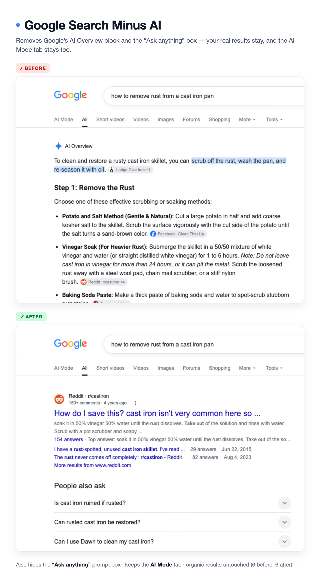

# Google Search Minus AI — Remove AI Overviews from Google Results

**A free Tampermonkey userscript that removes Google's AI Overview block and the "Ask anything" box from search results, leaving the real links.**

Google puts a generated AI Overview above your results and an "Ask anything" prompt box below the tabs. Both take up the screen, neither can be turned off in Google's settings, and the Overview is often wrong. This userscript deletes the Overview and hides the prompt box, so the first thing you see is a real website.

> **Short answer:** install the script, search on Google, and the AI Overview and "Ask anything" box are gone. The **AI Mode** tab stays, and your organic results are untouched.

## What changed in v2

v1 of this script appended ` -ai` to your search query. That was the wrong approach: it changed what you searched for rather than removing anything, and Google ignores `-ai` for AI Overviews — the block still appeared. **v2 removes the AI Overview element from the page instead**, which is what the script always claimed to do.

## What it does

- **Removes the AI Overview block** — deleted from the DOM, not just hidden behind a gap
- **Hides the "Ask anything" prompt box** — the empty pill under the nav tabs, plus the ~190px empty wrapper it leaves behind
- **Keeps the AI Mode tab** — that's a link to a separate product, not the inline Overview
- **Leaves every organic result intact** — verified: 6 results before, 6 after
- **Catches late-loaded blocks** — a MutationObserver removes them even when Google streams them in after first paint
- **Does nothing when there's nothing to remove** — verified on pages without an AI Overview, zero changes
- **No network requests, no tracking, no API key**

## Install

1. Install [Tampermonkey](https://www.tampermonkey.net/), Violentmonkey or Greasemonkey.
2. In Chrome or Brave 138+, open `chrome://extensions`, find Tampermonkey, and enable **Allow User Scripts**.
3. Open the raw script: **[google-search-minus-ai.user.js](https://raw.githubusercontent.com/0xCosmosly/GoogleSearch-MinusAI/main/google-search-minus-ai.user.js)**
4. Click **Install** when Tampermonkey prompts.
5. Search on Google. The AI Overview and prompt box are gone.

## Frequently asked questions

### What is a Google AI Overview?

An AI Overview is the generated summary Google places above search results. It answers the query directly using Gemini, and it appears for a large share of queries whether you want it or not. There is no supported way to disable it in Google's settings.

### Does this block AI Overviews or just hide them?

It removes the element from the DOM. The block is not collapsed or made transparent — it is deleted, so the results below it move up.

### Why does the AI Mode tab still show?

AI Mode is a separate Google product you navigate to, not the inline Overview block. This script deliberately leaves it, because removing navigation is a different decision from removing injected content.

### Will it break my search results?

No. The script locates the AI Overview's own container and removes only that node, with a guard that refuses to touch the results column. Tested against real result pages: the organic result count is identical before and after.

### Does it work if there's no AI Overview on the page?

Yes, and it does nothing. It scans for the block, finds none, and stops. No layout changes, no flicker.

### Does it change my search query?

No — that was v1's mistake. Your query is sent exactly as typed.

### Does it cost money or need an API key?

No. It is pure DOM manipulation in your browser. No requests leave your machine.

### Does it work on other Google domains?

It matches `www.google.com/search`. Other domains (`.co.uk`, `.de`, …) can be added by editing the `@match` line.

## How it works

Google renders the AI Overview as a self-contained block inside the results column (`#rcnt`), headed by the literal text "AI Overview". The wrapper class names are hashed and change with every Google deploy, so the script anchors on the heading text and walks up the tree to the outermost node that still contains **only** that block, then removes it.

The "Ask anything" box is found by its textarea placeholder. Hiding the pill alone leaves a blank band, because Google keeps an empty wrapper (`#Odp5De`) reserving height — so that shell is collapsed too, but only when it contains no text, no nav and no results.

| Element | How it's found |
|---|---|
| Results column | `#rcnt`, falling back to `#center_col`, `#search`, `main` |
| AI Overview heading | a leaf node whose text is exactly `AI Overview` |
| Block to remove | outermost ancestor whose text length equals the card's |
| Ask anything box | `textarea[placeholder="Ask anything"]` |
| Empty shell | `#Odp5De`, only when empty |
| Safety guards | never removes the results column or the nav tabs |
| Late injection | debounced `MutationObserver`, disconnected after 30 s |

Tested live against Google search in November 2026:

| Page | Before | After |
|---|---|---|
| Query with an AI Overview | Overview present, 6 results | **removed, 6 results** |
| Second query with an Overview | present, 5 results | removed, 5 results, real link first |
| Query without an Overview | no block, 9 results | **0 removals**, 9 results |
| Page with the Ask anything box | pill + 190px blank band | **pill hidden, band collapsed**, first result at y=222 |

## Troubleshooting

| Symptom | Fix |
|---|---|
| Nothing happens | Enable **Allow User Scripts** on the Tampermonkey card in `chrome://extensions`, then reload. |
| The block flashes then disappears | Expected — Google injects it after first paint, the observer removes it. |
| A blank band under the nav tabs | Update to v2.6+, which collapses the leftover wrapper. |
| Still seeing it on a non-.com domain | Add that domain to the `@match` line. |
| Google changed the heading text | The script matches the literal `AI Overview` label; open an issue with the current wording. |

## Compatibility

| | |
|---|---|
| **Tested on** | Brave 156 (Chromium 145), Google Search, November 2026 |
| **Browsers** | Any Chromium or Firefox build with Tampermonkey, Violentmonkey or Greasemonkey |
| **Matches** | `*://www.google.com/search*` |
| **Permissions** | None — `@grant none`, no network access |
| **Version** | 2.6 |

## Changelog

- **2.6** — Collapses the empty `#Odp5De` wrapper so hiding the prompt box no longer leaves a ~190px blank band under the nav tabs.
- **2.5** — Climb to the outermost widget shell instead of stopping at the first container.
- **2.4** — Stop climbing when an ancestor contains results or the nav tabs.
- **2.3** — Handle `display: contents` wrappers, which measure as zero height and broke the first climb.
- **2.2** — Hide the "Ask anything" prompt box; keep the AI Mode tab.
- **2.0** — Rewritten to actually remove the AI Overview block. v1 appended ` -ai` to the query, which changed the search and left the AI Overview in place.

## License

MIT
